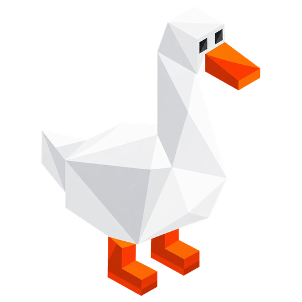

<p align="center">
  
</p>

# GooseStation - PlayStation 1, aka. PSX Emulator
[Features](#features) | [Downloading and running](#downloading-and-running) | [Building](#building) | [Licence and credits](#licence-and-credits)

GooseStation is a simulator/emulator of the Sony PlayStation(TM) console, focusing on playability, speed, and long-term maintainability. The goal is to be as accurate as possible while maintaining performance suitable for low-end devices. "Hack" options are discouraged, the default configuration should support all playable games with only some of the enhancements having compatibility issues.

GooseStation is a fork of [DuckStation](https://codeberg.org/vimuser/duckstation), taken from its last commit published under the GPLv3 (`a5bf1ba5cee7`, 2024-09-01). It adds **memory card sync**: memory cards are synchronised save by save between your devices through S3-compatible storage, using [emusync](https://github.com/ilyalissoboi/emusync). GooseStation is not affiliated with DuckStation or its developers; please do not report GooseStation issues to them.

A PS1 or PS2 "BIOS" ROM image is required to to start the emulator and to play games. You can use an image from any hardware version or region, although mismatching game regions and BIOS regions may have compatibility issues. A ROM image is not provided with the emulator for legal reasons, you should dump this from your own console using Caetla or other means.

## Features

GooseStation has a full desktop frontend built with Qt, and a fullscreen/TV UI ("Big Picture") based on Dear ImGui.

 - Memory card sync between devices with emusync (Settings -> Memory Cards).
 - CPU Recompiler/JIT (x86-64, armv7/AArch32, AArch64, RISC-V/RV64).
 - Hardware (D3D11, D3D12, OpenGL, Vulkan, Metal) and software rendering.
 - Upscaling, texture filtering, and true colour (24-bit) in hardware renderers.
 - Accurate blending via Rasterizer Order Views/Fragment Shader Interlock.
 - PGXP for geometry precision, texture correction, and depth buffer emulation.
 - Motion adaptive deinterlacing.
 - Adaptive downsampling filter.
 - Screen rotation for vertical or "TATE" shmup games.
 - Post processing shader chains (GLSL and Reshade FX).
 - "Fast boot" for skipping BIOS splash/intro.
 - Save state support, with runahead and rewind.
 - Windows, Linux, macOS support.
 - Supports reading directly from CD, bin/cue images, raw bin/img files, MAME CHD, single-track ECM, MDS/MDF, and unencrypted PBP formats.
 - Preloading of disc images to RAM to avoid disk sleeping hitches.
 - Automatic loading/applying of PPF patches.
 - Direct booting of homebrew executables.
 - Direct loading of Portable Sound Format (psf) files.
 - Time stretched audio when running outside of 100% speed, and surround sound expansion.
 - Digital and analog controllers for input (rumble is forwarded to host).
 - GunCon and Justifier lightgun support (simulated with mouse).
 - NeGcon support.
 - Automatic content scanning - game titles/hashes are provided by redump.org.
 - Optional automatic switching of memory cards for each game.
 - Supports loading cheats from existing lists.
 - Memory card editor and save importer.
 - Emulated CPU overclocking.
 - Integrated and remote debugging.
 - Multitap controllers (up to 8 devices).
 - RetroAchievements.
 - Video capture with Media Foundation (Windows) and [FFmpeg](https://www.ffmpeg.org/) (All Platforms) backends.

## System Requirements
 - Windows 10 (1809) or later, macOS 14.4 or later, or a Linux distribution as recent as Ubuntu 22.04 (the oldest each supports with Qt 6.12).
 - A CPU faster than a potato. But it needs to be x86_64 (SSE4.1), AArch32/armv7, AArch64/ARMv8, or RISC-V/RV64.
 - For the hardware renderers, a GPU capable of OpenGL 3.1/OpenGL ES 3.1/Direct3D 11 Feature Level 10.0 (or Vulkan 1.0) and above. So, basically anything made in the last 10 years or so.
 - SDL, XInput or DInput compatible game controller (e.g. XB360/XBOne/XBSeries). DualShock 3 users on Windows will need to install the official DualShock 3 drivers included as part of PlayStation Now.

## Downloading and running
GooseStation is in early development. Its builds are published as the [preview release](https://github.com/ilyalissoboi/goosestation/releases/tag/preview), which is replaced by hand with newer builds from time to time; its title gives the version, such as `0.1-49`. Or [build it yourself](#building).

| Platform | Download |
|---|---|
| Windows x64 | `goosestation-windows-x64-release.zip`: extract it to a folder and run `goosestation-qt-x64-ReleaseLTCG.exe`. |
| Windows ARM64 | `goosestation-windows-arm64-release.zip`, the same way. |
| Linux x86_64 | `GooseStation-x64.AppImage`: make it executable (`chmod +x`) and run it. `goosestation-x64.flatpak` installs with `flatpak install --user goosestation-x64.flatpak`. |
| macOS (Universal) | `goosestation-mac-release.zip`: extract it and move `GooseStation.app` to Applications. The app is not notarized yet, so the first time, right-click it and choose Open. |

The Windows, macOS and AppImage builds can update themselves from the preview release (Help > Check for Updates).

GooseStation keeps its own settings, memory cards and save states, separate from DuckStation's (see [User directories](#user-directories)).

### LibCrypt protection and SBI files

A number of PAL region games use LibCrypt protection, requiring additional CD subchannel information to run properly. libcrypt not functioning usually manifests as hanging or crashing, but can sometimes affect gameplay too, depending on how the game implemented it.

For these games, make sure that the CD image and its corresponding SBI (.sbi) file have the same name and are placed in the same directory. GooseStation will automatically load the SBI file when it is found next to the CD image.

For example, if your disc image was named `Spyro3.cue`, you would place the SBI file in the same directory, and name it `Spyro3.sbi`.

CHD images with built-in subchannel information are also supported.

## Building

### Windows
Requirements:
 - Visual Studio 2026 or 2022, with the "Desktop development with C++" workload
 - CMake, Ninja, 7-Zip and Git for Windows (for `patch.exe`)

1. Clone the repository: `git clone https://github.com/ilyalissoboi/goosestation.git`.
2. Build the dependencies (this takes a while): run `scripts\deps\build-dependencies-windows-x64.bat`. They are installed into `dep\msvc\deps-x64`.
3. Open the Visual Studio solution `duckstation.sln` in the root, or build from a developer command prompt: `msbuild duckstation.sln /m /p:Configuration=Release /p:Platform=x64`.
4. Binaries are located in `bin\x64`.
5. Run `goosestation-qt-x64-Release-MSVC.exe` (the name follows the configuration you built).

### Linux

#### Required Dependencies

Ubuntu/Debian package names:
```
build-essential clang cmake curl extra-cmake-modules git libasound2-dev libcurl4-openssl-dev libdbus-1-dev libdecor-0-dev libegl-dev libevdev-dev libfontconfig-dev libfreetype-dev libgtk-3-dev libgudev-1.0-dev libharfbuzz-dev libinput-dev libopengl-dev libpipewire-0.3-dev libpulse-dev libssl-dev libudev-dev libwayland-dev libx11-dev libx11-xcb-dev libxcb1-dev libxcb-composite0-dev libxcb-cursor-dev libxcb-damage0-dev libxcb-glx0-dev libxcb-icccm4-dev libxcb-image0-dev libxcb-keysyms1-dev libxcb-present-dev libxcb-randr0-dev libxcb-render0-dev libxcb-render-util0-dev libxcb-shape0-dev libxcb-shm0-dev libxcb-sync-dev libxcb-util-dev libxcb-xfixes0-dev libxcb-xinput-dev libxcb-xkb-dev libxext-dev libxkbcommon-x11-dev libxrandr-dev lld llvm nasm ninja-build pkg-config zlib1g-dev
```

Fedora package names:
```
alsa-lib-devel brotli-devel clang cmake dbus-devel egl-wayland-devel extra-cmake-modules fontconfig-devel gcc-c++ gtk3-devel libavcodec-free-devel libavformat-free-devel libavutil-free-devel libcurl-devel libdecor-devel libevdev-devel libICE-devel libinput-devel libSM-devel libswresample-free-devel libswscale-free-devel libX11-devel libXau-devel libxcb-devel libXcomposite-devel libXcursor-devel libXext-devel libXfixes-devel libXft-devel libXi-devel libxkbcommon-devel libxkbcommon-x11-devel libXpresent-devel libXrandr-devel libXrender-devel lld llvm make mesa-libEGL-devel mesa-libGL-devel nasm ninja-build openssl-devel patch pcre2-devel perl-Digest-SHA pipewire-devel pulseaudio-libs-devel systemd-devel wayland-devel xcb-util-cursor-devel xcb-util-devel xcb-util-errors-devel xcb-util-image-devel xcb-util-keysyms-devel xcb-util-renderutil-devel xcb-util-wm-devel xcb-util-xrm-devel zlib-devel
```

#### Building

1. Clone the repository: `git clone https://github.com/ilyalissoboi/goosestation.git`, `cd goosestation`.
2. Build dependencies. You can save these outside of the tree if you like. This will take a while. `scripts/deps/build-dependencies-linux.sh deps`.
3. Run CMake to configure the build system. Assuming a build subdirectory of `build-release`, run `cmake -B build-release -DCMAKE_C_COMPILER=clang -DCMAKE_CXX_COMPILER=clang++ -DCMAKE_EXE_LINKER_FLAGS_INIT="-fuse-ld=lld" -DCMAKE_MODULE_LINKER_FLAGS_INIT="-fuse-ld=lld" -DCMAKE_SHARED_LINKER_FLAGS_INIT="-fuse-ld=lld" -DCMAKE_PREFIX_PATH="$PWD/deps" -G Ninja`. If you want a release (optimized) build, include `-DCMAKE_BUILD_TYPE=Release -DCMAKE_INTERPROCEDURAL_OPTIMIZATION=ON`.
4. Compile the source code. For the example above, run `ninja -C build-release`
5. Run the binary, located in the build directory under `./build-release/bin/goosestation-qt`.

### macOS

Requirements:
 - CMake
 - Xcode 16 or later (Qt 6.12 needs the macOS 15 SDK)

1. Clone the repository: `git clone https://github.com/ilyalissoboi/goosestation.git`.
2. Build the dependencies. This will take a while. `scripts/deps/build-dependencies-mac.sh deps`.
3. Run CMake to configure the build system: `cmake -Bbuild-release -DCMAKE_BUILD_TYPE=Release -DCMAKE_INTERPROCEDURAL_OPTIMIZATION=ON -DCMAKE_PREFIX_PATH="$PWD/deps"`.
4. Compile the source code: `cmake --build build-release --parallel`.
5. Run the binary, located in the build directory under `bin/GooseStation.app`.

## User Directories
The "User Directory" is where you should place your BIOS images, where settings are saved to, and memory cards/save states are saved by default.
An optional [SDL game controller database file](#sdl-game-controller-database) can be also placed here.

This is located in the following places depending on the platform you're using:

- Windows: My Documents\GooseStation
- Linux: `$XDG_DATA_HOME/goosestation`, or `~/.local/share/goosestation`.
- macOS: `~/Library/Application Support/GooseStation`.

So, if you were using Linux, you would place your BIOS images in `~/.local/share/goosestation/bios`. This directory will be created upon running GooseStation
for the first time.

If you wish to use a "portable" build, where the user directory is the same as where the executable is located, create an empty file named `portable.txt`
in the same directory as the GooseStation executable.

## Bindings for Qt frontend
Your keyboard or game controller can be used to simulate a variety of PlayStation controllers. Controller input is supported through DInput, XInput, and SDL backends and can be changed through `Settings -> General Settings`.

To bind your input device, go to `Settings -> Controllers`. Each of the buttons/axes for the simulated controller will be listed, alongside the corresponding key/button on your device that it is currently bound to. To rebind, click the box next to the button/axis name, and press the key or button on your input device that you wish to bind to. When binding rumble, simply press any button on the controller you wish to send rumble to.

## SDL Game Controller Database
GooseStation ships with a database of game controller mappings for the SDL controller backend, courtesy of https://github.com/mdqinc/SDL_GameControllerDB. The included `gamecontrollerdb.txt` file can be found in the `resources` subdirectory of the GooseStation program directory.

If you are experiencing issues binding your controller with the SDL controller backend, you may need to add a custom mapping to the database file. Make a copy of `gamecontrollerdb.txt` and place it in your [user directory](#user-directories) (or directly in the program directory, if running in portable mode) and then follow the instructions in the [SDL_GameControllerDB repository](https://github.com/mdqinc/SDL_GameControllerDB) for creating a new mapping. Add this mapping to the new copy of `gamecontrollerdb.txt` and your controller should then be recognized properly.

SDL hints can also be set in the `[SDLHints]` section of `settings.ini`, one `NAME = value` per line. GooseStation uses SDL3, so the names are SDL3's: some SDL2 hints were renamed or removed, and those do nothing.

## Default bindings
Controller 1:
 - **Left Stick:** W/A/S/D
 - **Right Stick:** T/F/G/H
 - **D-Pad:** Up/Left/Down/Right
 - **Triangle/Square/Circle/Cross:** I/J/L/K
 - **L1/R1:** Q/E
 - **L2/R2:** 1/3
 - **L3/R3:** 2/4
 - **Start:** Enter
 - **Select:** Backspace

Hotkeys:
 - **Escape:** Open Pause Menu
 - **F11:** Toggle Fullscreen
 - **Tab:** Temporarily Disable Speed Limiter
 - **Space:** Pause/Resume Emulation

## Licence and credits

GooseStation is licensed under the [GNU General Public License v3.0](LICENSE). It is based on DuckStation by Connor McLaughlin (Stenzek) and its [contributors](CONTRIBUTORS.md); their copyright notices are kept in the source files. Code DuckStation published after the fork is under other licences and is not used here.

"PlayStation" and "PSX" are registered trademarks of Sony Interactive Entertainment Europe Limited. This project is not affiliated in any way with Sony Interactive Entertainment.
