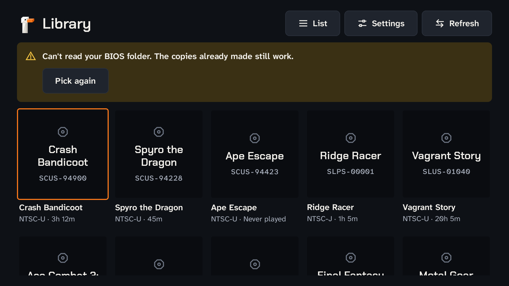
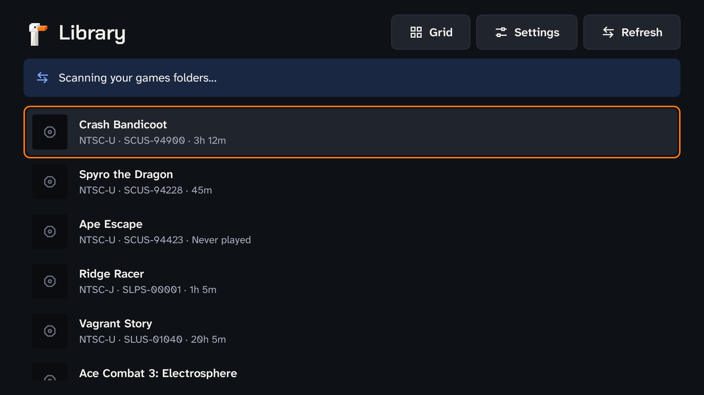
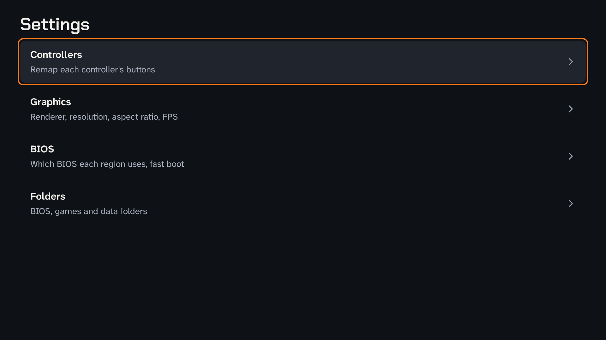
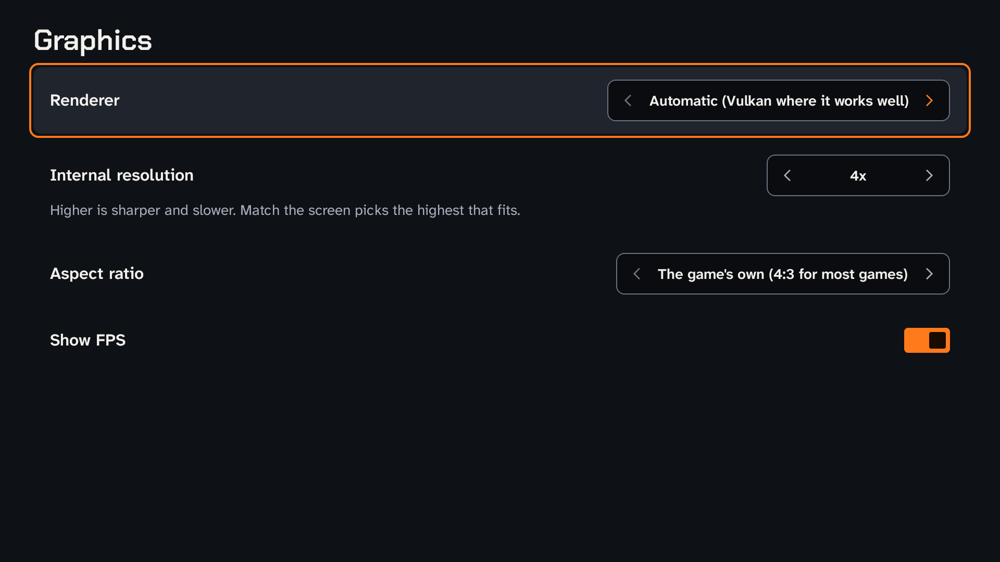
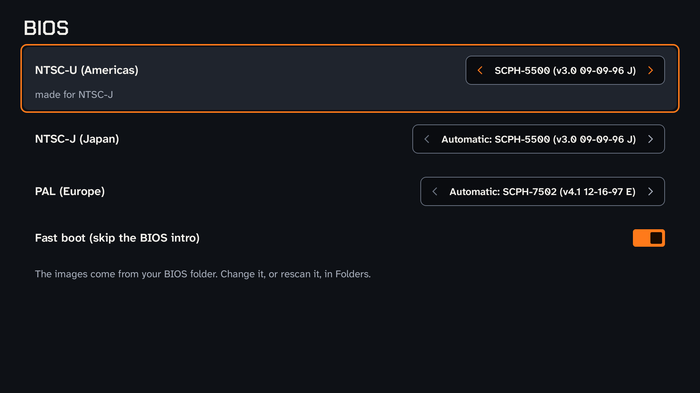
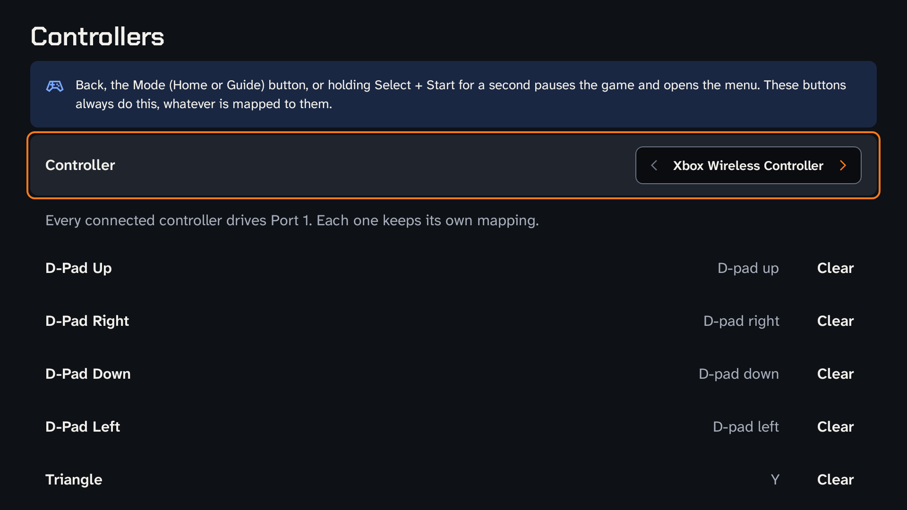
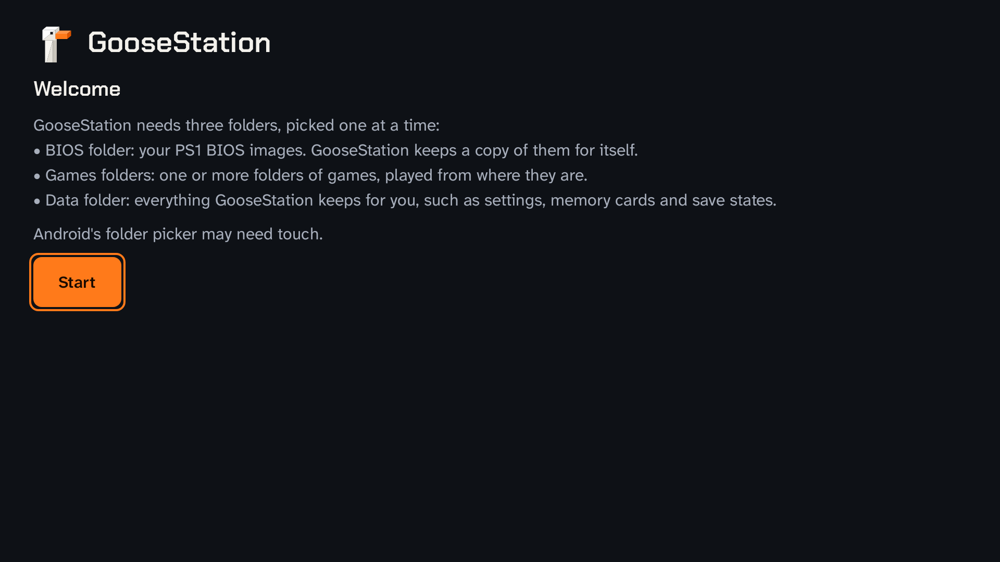
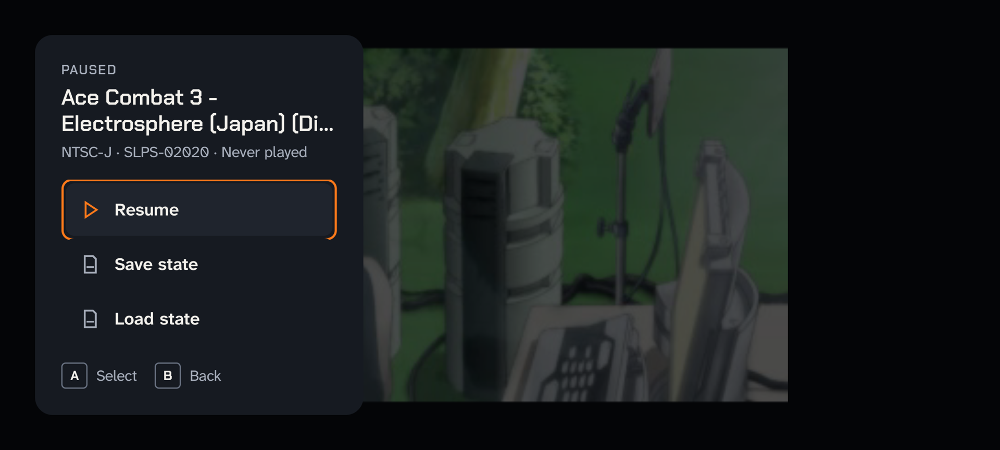
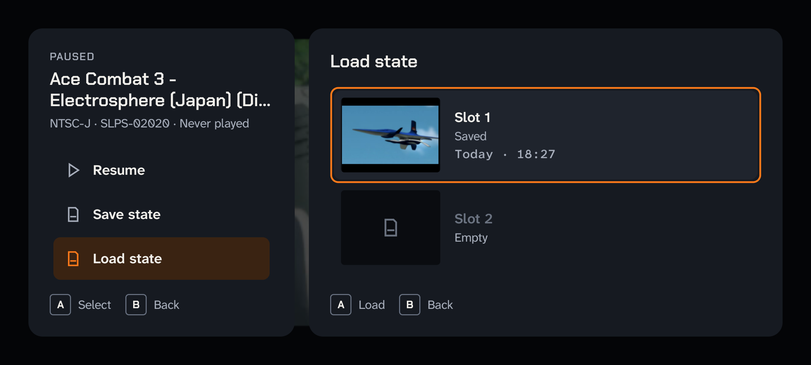
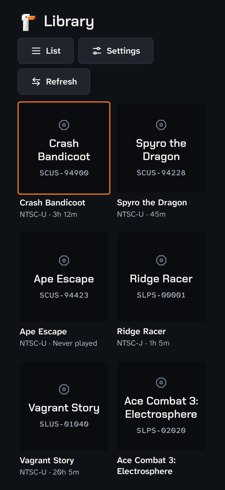

<!-- SPDX-FileCopyrightText: 2026 GooseStation contributors -->
<!-- SPDX-License-Identifier: GPL-3.0 -->

# The GooseStation design system

How GooseStation looks and behaves, and how to build a new screen or control that fits. Read this before adding UI to
any frontend.

GooseStation is played at a desk with a mouse, on a sofa with a pad, on a TV with a remote, and on a phone with
thumbs. The design system makes those four feel like one app. Its look comes from the goose: white low-poly facets
with an orange beak, on the dark water of a night pond.

## Where things are

| What | Where |
| --- | --- |
| The values (colours in both themes, type, spacing, radii, sizes), machine-readable | [`docs/design-system/tokens.json`](design-system/tokens.json) |
| The UI icons, as SVG | [`docs/design-system/icons/`](design-system/icons/) |
| The goose mark, app icon and one-colour mark, as SVG | [`docs/design-system/logos/`](design-system/logos/) |
| The full goose illustration | [`data/resources/images/goosestation.png`](../data/resources/images/goosestation.png) |
| The Android theme, icons, mark | `android/app/src/main/java/io/github/ilyalissoboi/goosestation/ui/theme/` |
| The Android components | `android/app/src/main/java/io/github/ilyalissoboi/goosestation/ui/components/` |
| The bundled fonts and their licences | `android/app/src/main/res/font/`, `android/app/src/main/assets/licenses/` |
| `GsIcons.kt`'s generator | [`scripts/branding/generate-gsicons.py`](../scripts/branding/generate-gsicons.py) |
| The Android launcher icon's generator | [`scripts/branding/generate-android-icon.py`](../scripts/branding/generate-android-icon.py) |

The design system is also published as a browsable page with live previews of every component, in both themes:
<https://claude.ai/artifact/BZV2gRHHmrSCzRmyWcrqwU> (ask a maintainer for access). `tokens.json` and the SVGs here are
the same values and files.

**What uses it today.** The Android app implements the dark theme and the components below. The desktop app (Qt)
and Big Picture (Dear ImGui) still have DuckStation's look; bringing them over is open work, and the tokens are the
source for it. When a value changes, change `tokens.json` and the implementations together.

## What it looks like

The Android app's screens, in [`docs/design-system/screenshots/`](design-system/screenshots/): rendered from the
Compose code, off a device, at a handheld's 960 x 540 dp in landscape (the AYN Thor's) and a phone's 411 x 891 dp in
portrait. The pause menu and its slot panel are from the emulator, a phone in landscape (914 x 411 dp), over Ace
Combat 3. The orange outline is the focus, where a controller is.

| | |
| --- | --- |
|  |  |
|  |  |
|  |  |
|  |  |
|  | |



## Principles

1. **The game is the hero.** Chrome stays dark, quiet and out of the way. Colour goes on the one thing to do next and
   on what needs attention, never on decoration.
2. **Every input is first-class.** Anything a mouse can do, a D-pad, a remote and a thumb can do too. Focus is always
   visible.
3. **Facets, not curves.** Corners are crisp: 4, 8 or at most 16 dp. No pills, no circles: switches are square, and
   round icons are octagons.
4. **Say it plainly.** Short words, sentence case, the truth about what happened and what to do next.
5. **Readable from across the room.** A hyperlegible text face, sizes that scale by 1.5 on a TV, and every text colour
   at 4.5:1 or more on the grounds it's used on.

## Colour

Name colours by role, never by value. Two themes share the names: **Dark** (the default, and the only one Android
has) and **Light** (for the desktop app, later). Values are in `tokens.json`; the dark ones are below.

| Token | Dark | Light | Use |
| --- | --- | --- | --- |
| `ground` | `#0e1116` | `#f3f1ec` | Every screen's background. |
| `surface` | `#161a21` | `#fbfaf7` | Groups, cards, the pause menu's panel. |
| `raised` | `#1f242d` | `#ffffff` | Secondary buttons; a focused or hovered row. |
| `sunken` | `#0a0c10` | `#e9e6df` | Wells: fields, toggle tracks, the cycler, a cover before its art. |
| `line` | `#2c323d` | `#dcd8cf` | Hairlines that divide. Never the only edge of a control. |
| `line-strong` | `#6a7383` | `#858072` | Edges that must be seen: toggles, the cycler, fields. 3:1 or more. |
| `ink` | `#f3f1ec` | `#14171c` | Text and icons people must read. |
| `ink-muted` | `#a7aebb` | `#525966` | Secondary text: notes, details, values at rest. |
| `ink-faint` | `#6b7381` | `#8a909a` | Disabled labels and placeholder glyphs only. |
| `beak` | `#ff7a1a` | `#f26a0f` | The one accent: the primary button, an on toggle, progress. |
| `beak-hover` | `#ff9447` | `#e0600a` | `beak` pressed or hovered. |
| `beak-ink` | `#ff7a1a` | `#a64100` | Orange as text or a thin mark: icons of the focused item. |
| `on-beak` | `#1a0b00` | `#1a0b00` | Text and icons on `beak`. Never white on orange. |
| `beak-soft` | `#3a2312` | `#fde3cf` | A quiet orange tint for a current item. Text on it stays `ink`. |
| `focus` | = `beak-ink` | = `beak-ink` | The focus ring. |
| `info` / `info-soft` | `#7aa7ff` / `#1a2742` | `#2b57c4` / `#dfe8fb` | Activity: syncing, scanning. |
| `success` / `success-soft` | `#3cc9b4` / `#12302d` | `#0b6e64` / `#d5efeb` | Done and safe. Teal, so it never relies on hue to differ from danger. |
| `warning` / `warning-soft` | `#f5c542` / `#3a3014` | `#7a5800` / `#f7ecc8` | Needs a look, nothing lost. |
| `danger` / `danger-soft` | `#ff6b81` / `#3d1820` | `#b01e3a` / `#f9dde2` | Failed, or destroys something. |
| `scrim` | 72% black | 48% ink | Dims what's under a dialog or the pause menu. |
| `viewport`, `osd`, `osd-ink`, `touch*` | | | Over the game picture: the same in both themes. |

Rules:

- **One accent.** `beak` fills at most one or two things on a screen: the primary button, an on toggle. If a screen
  has more orange than that, something is wrong.
- **Text on orange is `on-beak`**, near-black, in both themes.
- **Grounds step up in lightness:** `sunken`, then `ground`, `surface`, `raised`. Depth comes from these steps, not
  shadows. Only things that float (dialogs, the pause menu) cast `shadow-overlay`.
- **Status always has an icon shape and a word**, never colour alone (see Icons).
- Each token's note in `tokens.json` lists the contrast it was checked at. A new pair of colours must reach 4.5:1 for
  text (3:1 for text 24 px and up, control edges, icons and the focus ring) in both themes.

## Type

Three families, all under the SIL Open Font License, from Google Fonts. Bundle the files in each app; don't rely on
the system's fonts.

- **Chakra Petch** (`display`): titles and key glyphs. Its clipped corners are the facets in letter form. 20 px and up,
  plus `eyebrow` and `key`. Never for paragraphs.
- **Atkinson Hyperlegible Next** (`text`): everything people read or press. Built so similar letters can't be mixed
  up at a distance.
- **Atkinson Hyperlegible Mono** (`mono`): serials, timestamps, paths, counters, with tabular figures.

| Style | Family, size / line, weight | Use | Android |
| --- | --- | --- | --- |
| `display` | display 40/44, 600 | One per screen at most: a hero title. | `typography.displaySmall` |
| `title-1` | display 28/32, 600 | Screen titles. | `typography.headlineMedium` |
| `title-2` | display 20/24, 600 | Sections, dialogs, a game's name, a setup step. | `typography.headlineSmall`, `titleLarge` |
| `eyebrow` | display 12/16, 600, +1 tracking, capitals | A small label over what it names. | `Eyebrow(text)` |
| `key` | display 12/16, 700 | A button's glyph in a key chip. | `GooseStationTheme.type.key` |
| `label` | text 16/20, 600 | Anything pressed or picked. | `typography.titleMedium` |
| `label-sm` | text 14/18, 600 | Badges, a cycler's value. | `typography.titleSmall`, `labelLarge` |
| `body-lg` | text 18/26, 400 | Lead copy in setup and empty states. | (not used yet) |
| `body` | text 16/24, 400 | Reading text. | `typography.bodyLarge` |
| `body-sm` | text 14/20, 400 | Notes under a label, a game's details. | `typography.bodyMedium` |
| `mono` | mono 14/20, 500 | Serials, times, versions. | `GooseStationTheme.type.mono` |
| `osd` | mono 16/20, 600 | Messages over the game. | `GooseStationTheme.type.osd` |

Write text in sentence case even where it shows in capitals: `Eyebrow("Paused")` shows "PAUSED".

**On a TV** (Big Picture, Android TV), multiply every type size, control height and the focus width by 1.5, and pad
screens with 48 dp inside the overscan-safe area.

## Space, size and shape

- **A 4 dp grid:** 4, 8, 12, 16, 24, 32, 48, 64 (`space-1` to `space-8`). Rows and buttons pad 16 or 24 at the sides,
  screens 32 (48 on a TV), sections sit 12 to 24 apart. Android uses these as `dp` literals.
- **Controls** are at least 48 dp tall on touch screens and TVs, which is also the smallest touch target; 40 dp is
  for pointer-only desktop controls.
- **Radii:** `radius-sm` 4 dp for small, tight things (badges, toggles, fields, covers), `radius-md` 8 dp for
  buttons, rows, notices and cards, `radius-lg` 16 dp for dialogs, the pause menu and sheets. Nothing rounder. In
  Compose: `GsShapes.small`, `.medium`, `.large`, also set as `MaterialTheme.shapes`.
- **Layouts must work at 360 dp wide with text at 1.3×**, in portrait and landscape. A label and its value share a
  line when they fit and stack when they don't; `LabelValue` does this for settings rows.
- **Motion** is brief and only where it explains something: focus moves and toggles at 120 ms, dialogs fading in at
  160 ms. Nothing moves while a game runs except on-screen messages fading. Honour the system's reduce-motion setting.

## Focus and input

Every screen must work with a D-pad alone. That's tested (see Checking a new screen).

- **Something always has focus.** When a screen opens, focus the thing the player most likely wants: the first row,
  the last game played, Resume. When the focused element goes away, move focus to the nearest sensible one.
- **The focus ring** is a 2 dp `focus` outline drawn 2 dp outside the element, at the element's radius. Rows also
  lift to `raised` under it. A game tile rings its cover, not the whole tile.
- **Because the ring is outside the element, give it room:** a scrolling or lazy container that clips needs at least
  4 dp of content padding around focusable items, or the ring is cut.
- **A, Enter, the D-pad centre or a tap activate.** Only an A *pressed* on the element counts, not the release of one
  held from the previous screen. `focusRing` does this.
- **B and Back go back** (from the innermost thing that takes Back first, such as a dialog).
- **Left and right step a value** on a cycler row; elsewhere they move focus sideways.
- **Nothing can be clicked that can't be focused.** A tap-only part, such as a cycler's arrows, uses
  `pointerInput` rather than `clickable`, so it isn't a separate focus stop, and the row it's in carries the action.

## Components

Each is in `ui/components/` unless noted. Use them before writing a new control.

### `ActionButton`

```kotlin
ActionButton("Pick folder", onClick = ::pick, icon = GsIcons.folder)
ActionButton("Next", onClick = ::next, enabled = ready, kind = ButtonKind.Primary)
ActionButton("Back", onClick = ::back, kind = ButtonKind.Ghost)
```

A command: a label (a verb, sentence case), an optional leading icon, at least 48 dp tall with 24 dp sides.

- `Primary` (`beak` fill, `on-beak` label): the one thing the screen is for. Once a screen.
- `Secondary` (the default; `raised`, a `line` edge, `ink` label): every other command.
- `Ghost` (no fill): Back, Cancel, Remove, low-stakes commands beside a primary.
- `Danger` (secondary with a `danger` label): deletes or overwrites. Ask first, or offer Undo afterwards.
- Disabled: `ink-faint` on `surface`, and it can't take focus. Say nearby why it's disabled.
- Buttons in a row sit 8 dp apart; use a `FlowRow` so they wrap on a narrow screen.

### `Modifier.focusRing` and `Modifier.focusIndicator` (`FocusRing.kt`)

```kotlin
Row(Modifier.fillMaxWidth().focusRing(role = Role.Button, onClick = ::open).padding(16.dp, 12.dp)) { … }
```

`focusRing` makes anything focusable and activatable the GooseStation way: the ring, the `raised` lift
(`focusedFill`, or `null` for none), A on key-up, no focus while disabled. Put it before the padding, so the ring and
the touch target cover the whole element. For a ring on part of an element, pass `ring = false` and
`onFocusChange`, and draw `Modifier.focusIndicator(focused, colors.focus, shape)` on the part, as `GameTile` does.

### `Notice` and `Banner` (`Banner.kt`)

```kotlin
Notice(NoticeStatus.Warning) {
    Text("Memory card sync is offline", style = MaterialTheme.typography.titleMedium, color = colors.ink)
}
Banner(BannerModel("Can't read your BIOS folder.", listOf("Pick again" to ::repick)))
```

A message in the page, on its status's `-soft` ground, with the status icon: `Info` (a square, or pass
`icon = GsIcons.sync` for activity), `Success` (a ticked square), `Warning` (a triangle), `Danger` (an octagon). A
`Banner` is a warning notice with up to two secondary actions. Notices go at the top of the content, most serious
first, and leave when their cause does. A notice never holds a primary button. `MessageBar` in `LibraryScreen.kt` is
the app's passing status line, an info or danger notice.

### Settings: `SettingsPage`, `CyclerRow`, `SwitchRow`, `NavRow` (`SettingsRows.kt`)

```kotlin
SettingsPage("Graphics", onBack = onBack) {
    CyclerRow("Internal resolution", choices, settings.scale, onSelect = { … }, note = "Higher is sharper.")
    SwitchRow("Show FPS", settings.showFps, onToggle = { … })
}
```

- `SettingsPage`: the title in `title-1`, the rows in a scrolling column, B and Back going back.
- `CyclerRow`: a setting with a few values, shown between two arrows. Left and right step and stop at the ends; A,
  Enter or a tap step forward, round to the first; a tap on an arrow steps its way. Each step is the change. A
  `Choice`'s `note` shows under the row while it's the current value. Values that aren't among the choices show as
  themselves. For more than about eight values, or values that need explaining, make a page of its own instead.
- `SwitchRow`: on/off, a square toggle and no word. The state is in the row's semantics (`toggleableState`), so
  screen readers say it and tests check it with `assertIsOn()`.
- `NavRow`: an entry that opens a page, with a summary of what's in it and a chevron. Disabled, its summary says why.
- A row's `note` explains a consequence ("Higher is sharper and slower.") or a fallback. Never repeat the label.

### `KeyHints` (`KeyHints.kt`)

```kotlin
KeyHints(listOf(KeyHint(PadGlyphs.confirm, "Select"), KeyHint(PadGlyphs.back, "Back")))
```

The button-hint footer: each button's glyph in a key chip (`key` type, a `line-strong` edge at `radius-sm`), then the
action it takes, in a row that wraps on a narrow screen. It goes at the foot of a panel, such as the pause menu.

- Name the buttons with `PadGlyphs`, which labels them as the Controllers page does ("A" for `BUTTON_A`).
- Actions are short verbs, in sentence case: Select, Back, Save.
- It takes no input: nothing in it is focusable, and each hint reads as "A: Select".

### `Eyebrow` (`Eyebrow.kt`)

A small capitalised label over what it names: "Paused" over a game's title, "Step 1 of 3" over a setup step.

### Library and game screens (`ui/`)

- `GameTile`: the cover in a square on `sunken`, fitted whole, never cropped; the disc icon, title and serial until
  the art loads; then the title (2 lines) and region · play time. Tiles are at least 152 dp wide, 16 dp apart across
  and 24 down.
- `GameListRow`: a 48 dp cover thumbnail, the title, then region · serial · play time.
- `GameMenu`: the pause menu. A `scrim` over the game, a `surface` panel at `radius-lg`, 300 dp wide, 32 dp from the
  edges: "Paused" over the game's title and details, then menu rows (an icon, a label and any value at the end;
  focused, the icon turns `beak-ink`; disabled, all `ink-faint`), a `line` divider before Reset console, and `KeyHints`
  at the foot. The row whose panel is open is current: `beak-soft`, its icon `beak-ink`. A question (Reset console)
  takes the rows' place in the panel: the question in `title-2`, then a `Danger` button and Cancel (`Ghost`, focused).
  B steps out one layer at a time, back to the row it came from.
- `SaveSlotPanel`: the slot list, a second `surface` panel beside the menu, filling the rest of the screen (on a
  screen under 720 dp wide, the menu narrows to 240 dp while it shows); on a narrow portrait screen, below it, the
  menu keeping the top 40%. Each slot row shows its screenshot at 4:3 (112 x 84
  dp, 64 x 48 dp in a row under 240 dp wide) on `sunken`, or the `memoryCard` icon in `ink-faint`; the slot's name in
  `label`; Saved or Empty; and the time in `mono`. Rows that can't be picked are disabled. Replacing a save asks in the
  panel, as the menu does. The focus can't leave the panel.
- `ResumePrompt`: "Resume where you left off?" over the library, a centred `surface` panel at `radius-lg`: the game's
  title, the resume state's screenshot (224 x 168 dp) and time, then Resume (`Primary`, focused) and Start over. The
  `scrim` takes every tap, and the focus can't leave the panel.
- `OsdLayer`: the messages over the running game, the app's and the core's, at the top left, oldest first, at most
  four. Each is `osd` type in `osd-ink` on the `osd` ground at `radius-sm`, with the core's icon (a memory card's,
  say) when it has one, showing its first frame only. The app's messages last 3 s, and the core's keep their own time.
  Each fades out over 160 ms, the only thing that moves during a game; with animations off, it just goes. While fast
  forward is on, its marker (the `fastForward` icon on `osd`) shows at the top right. On Android the core's messages
  are routed here, not to its own OSD: `CoreMessages` puts those for the in-game menu's actions in the app's words
  and drops those the app says itself. The core's FPS and speed overlay is unchanged.

### `GooseMark` (`ui/theme/GooseMark.kt`)

The goose mark, drawn in code from `logos/goose-mark.svg`'s polygons. Full colour, for dark grounds only. It sits
beside a screen's title on the library and setup screens.

## Icons

- **The UI icons** (`docs/design-system/icons/`) are drawn for GooseStation on a 24 px grid: 2 px strokes, square
  caps, mitred corners, and octagons wherever an icon would use a circle. In Compose they're `GsIcons.play`,
  `GsIcons.memoryCard` and so on, used through `Icon(…, tint = …)` at 16, 20 or 24 dp.
- **Colour them by context:** `ink-muted` at rest, `beak-ink` when focused or current, the status colour inside a
  notice. They're always paired with a word unless the meaning is universal (close, settings) and the element has an
  accessible name.
- **Status icons differ in shape** (square, ticked square, triangle, octagon) so they read without colour.
- **To add an icon:** draw it in the same style as an SVG in `docs/design-system/icons/`, using only `<polygon>`,
  `<polyline>`, `<rect>` and `<path>` with absolute `M`, `L`, `H` and `V`, stroked `#14171c`. Then run
  `python scripts/branding/generate-gsicons.py`, which rewrites `GsIcons.kt` from the folder. Don't edit `GsIcons.kt`
  by hand.
- **The goose:** `goosestation.png` is the hero illustration (about box, setup welcome, store pages), dark grounds
  only. `logos/goose-mark.svg` is the same goose cropped to head, neck and beak, for small sizes;
  `goose-app-icon.svg` is the mark on a dark tile, the app icon and the mark to use on light grounds;
  `goose-mark-mono.svg` is the one-colour silhouette for Android notification and themed icons and the macOS menu
  bar. Never recolour or redraw the goose. The wordmark is the name in Chakra Petch 600 beside the mark; there's no
  logotype file.
- **The Android launcher icon** is an adaptive icon made from the goose mark, in vector layers on the 108 dp canvas
  (`res/mipmap-anydpi/ic_launcher.xml`): the `surface`-dark background, the mark in full colour as the foreground, its
  head and beak inside the 66 dp safe circle and its neck running off the bottom edge, so the goose rises out of
  whatever shape the launcher masks it to; and the silhouette as the monochrome layer, which Android 13 and up tint
  for themed icons. With `minSdk` 29, vectors cover every supported version, so there are no PNGs per density. It's
  generated from `logos/goose-mark.svg` and `goose-mark-mono.svg` by
  `python scripts/branding/generate-android-icon.py`, which also checks the safe zone; change the mark there, not
  the XML. The desktop icons (`scripts/branding/generate-icons.py`) still use the full goose.
- **No emoji** and no decorative illustrations in the interface. The only pictures are the players' covers and
  screenshots.

## Writing

- **Sentence case** everywhere, titles and buttons included. The name is **GooseStation**: one word, two capitals.
- **Talk to the player as *you*.** The app calls itself GooseStation, never *I* or *we*.
- **Buttons are verbs:** Play, Resume, Add folder, Pick folder, Sync now. Never "OK" when the button can say what it
  does.
- **Say what's true, then the way forward:** "Memory card sync is offline. Your saves stay on this device and sync
  when you're back online." No apologies, no blame, no exclamation marks.
- **Show progress as a present-tense line ending in the ellipsis character (…):** "Scanning your games folders…".
- **Join details with " · "** ("NTSC-U · SCUS-94900 · 3h 12m") and leave out a part that's blank.
- **Numbers:** play time as "3h 12m"; save times in 24-hour form; serials as printed. Use the hardware's own words:
  PS1, BIOS, disc, memory card, save state, controller; NTSC-U, NTSC-J, PAL.

## Building a new screen or control

1. **Look for a component first.** Combine `SettingsPage`, rows, `ActionButton` and `Notice` before writing a new
   control.
2. **Wrap the screen in `GooseStationTheme`** (the activity already does) and take colours from
   `GooseStationTheme.colors` or `MaterialTheme.colorScheme`, type from `MaterialTheme.typography` or
   `GooseStationTheme.type`, shapes from `GsShapes`. No `Color(0x…)` literals and no font sizes in screens.
3. **Make every activatable thing `focusRing`ed**, focus something when the screen opens, and leave 4 dp for the
   ring in clipping containers.
4. **Give it the touch size** (48 dp tall at least) and let it wrap: `FlowRow` for button rows, `LabelValue` for a
   label and a value.
5. **A new component** that others will reuse goes in `ui/components/`, with a KDoc saying what it shows, what the
   caller provides and how it responds to each input. Add it to this document.
6. **A new value** (a colour, a size) goes in `tokens.json` first, with a usage note and, for a colour, its contrast on
   the grounds it's used on in both themes. Then add it to `GsColors` or the right place in `Theme.kt`.

### Checking a new screen

The instrumented tests (`android/app/src/androidTest/…/ui/`) hold every screen to the system:

- `FocusAuditTest`, through `assertControllerReady()`: something has focus, and everything clickable can be focused.
  Add the new screen to it.
- `OrientationLayoutTest`: at phone and handheld sizes, portrait and landscape, at text 1.0× and 1.3×, no text is cut
  off, broken mid-word, overlapping or off-screen, and every focusable is reached with the D-pad and scrolled into
  view. Add settings pages and anything with long, user-supplied text to it.
- A screen test of its own, driving it with keys (`pressKey(Key.DirectionDown)`, `Key.Enter`, `Key.ButtonB`) and
  checking what's focused, as `SettingsRowsTest` does.

See [docs/android.md](android.md) for running them.

## Not built yet

The design system defines these, and the published page previews them, but no app has them yet: a light theme on
Android; badges for region and memory card sync;
progress bars; on-screen touch controls; the
desktop nav rail; and the whole desktop app and Big Picture. Build them from the published page's previews and the
tokens.
